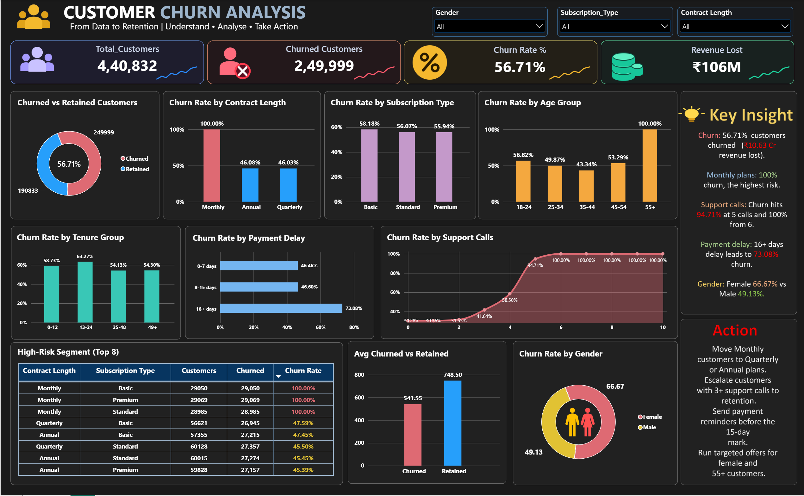

# Customer Churn Analysis

## Project Overview
An end-to-end customer churn analysis project using SQL Server and Power BI to identify churn patterns and high-risk customer segments.

## Dashboard Preview

## Tools Used
- SQL Server (SSMS)
- SQL
- Power BI
- DAX

## Key Performance Indicators
- Total Customers: 440,832
- Churned Customers: 249,999
- Churn Rate: 56.71%
- Revenue Lost: 106,263,646 (based on available Total_Spend values)

## Analysis Performed
- Churned vs. retained customers
- Churn by contract length
- Churn by subscription type and gender
- Churn by age and tenure groups
- Impact of support calls and payment delays
- High-risk customer segments
- Average spend comparison

## Key Findings
- Monthly contracts show a 100% churn rate, versus about 46% for Quarterly and Annual.
- Churn reaches 94.71% at 5 support calls and 100% from 6 calls.
- Customers with 16+ days payment delay churn at 73.08%.
- Female customers churn at 66.67% versus 49.13% for male.
- The 55+ age group shows 100% churn.

## Recommendations
- Move Monthly customers to Quarterly or Annual plans.
- Escalate customers with 3+ support calls to a retention team.
- Send payment reminders before the 15-day mark.

## Project Files
- `Customers_Churn_Analysis.sql` : SQL queries
- `Customer_Churn_Dashboard.pbix` : Power BI dashboard
- `customer_churn_dataset.csv` : Dataset

## Note
Revenue analysis uses available spend values; missing values may affect interpretation.

